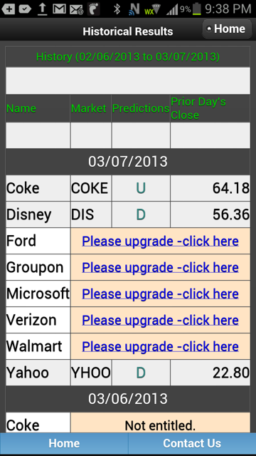
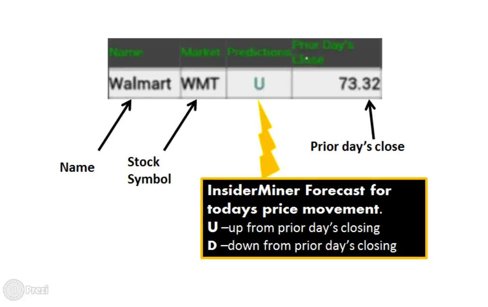
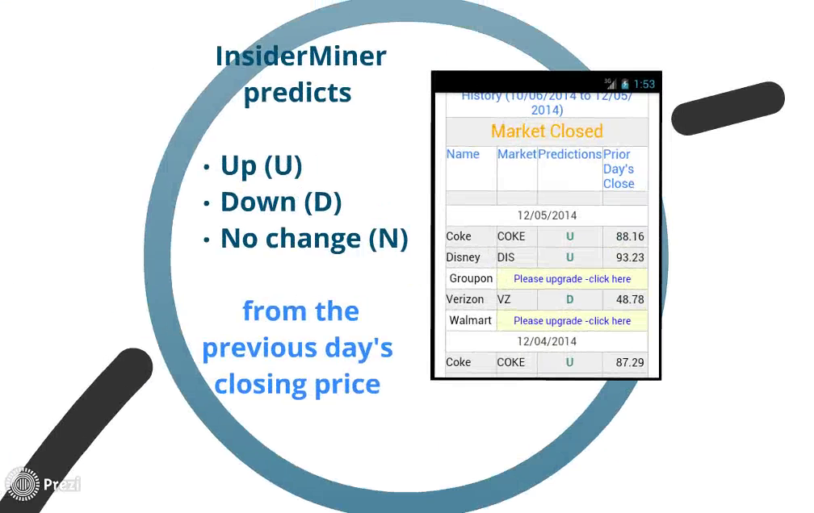
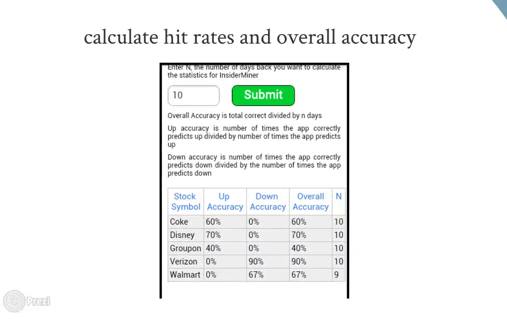

# InsiderMiner

InsiderMiner was a stock forecasting system built between 2010 and 2014 by William B. Claster, co-founder, CTO and chief scientist. Each trading morning it predicted whether a stock would close up, down or unchanged, using the volume of social-media discussion about the company together with recent price behavior. The predictions were published through Android and iPhone apps.

This repository preserves the original source code. It is published as a historical record and is not maintained.

## The app

  

*The Android app's prediction history screen, March 7, 2013. Each row shows the stock, its symbol, the forecast for the day (U for up, D for down) and the prior day's close. Stocks outside the user's subscription show an upgrade link.*

  

*From the 2014 promotional video: how to read a forecast.*

  

*Daily predictions as shown in the app, December 2014.*

  

*The app's accuracy screen. Users could choose a number of past days and see up, down and overall accuracy for each stock.*

## How the system worked

1. **Tweet collection.** A Perl script collected tweets mentioning each tracked company and saved them as daily CSV files.
2. **Feature construction (Excel VBA).** A set of macros imported the daily files, estimated tweet counts, normalized each company's count by the total tweet volume for the day, and shifted tweet times so that only tweets posted before the market opened counted toward that day. Weekend activity was folded into the next trading day. The macros then joined the counts with daily prices and built the model inputs: close minus open, the day's range, today's open minus yesterday's close, normalized volume, the ratio of tweet count to volume, interaction terms, and up to 20 days of lagged tweet counts and price fields. The target label was U, D or N.
3. **Model selection (Weka).** Many classifiers were compared on each stock, including Bayesian networks, J48 decision trees, logistic model trees, JRip rule learners, LogitBoost, MultiBoostAB and bagging, across different training periods and feature sets.
4. **Prediction (Java and Weka).** A Java program read the training table from a MySQL database, trained the model, classified the current day, and wrote the prediction and the latest price back to the database at about 8:30 a.m. New York time. The first automated version used a Weka J48 decision tree.
5. **Delivery (mobile app).** A PhoneGap app for Android and iPhone read the prediction table and showed an up, down or no-change forecast for each stock. Free and paid versions differed in the number of stocks and days per week a user could view.

Stocks tracked at various times included Sony (Tokyo, 6758), Toyota (Tokyo), Coca-Cola, Ford, Disney, Groupon, Microsoft, Verizon, Walmart and Yahoo.

### Model inputs

The final Sony training table had 94 columns. Social-media volume was one input among many.

| Group | Columns |
|---|---|
| Tweet counts: current day and lags of 1 to 20 days | 21 |
| Open, close, high and low prices, each lagged 1 to 10 days | 40 |
| Close-minus-open spread, lagged 1 to 9 days | 9 |
| Today's open minus yesterday's close, lagged 1 to 10 days | 10 |
| Interaction terms combining counts, prices, the market index and date | 5 |
| Other lagged market fields: volume, NYSE change, count-to-volume ratio, normalized volume, daily range | 5 |
| Date, data-quality flag and the U/D/N label | 4 |

## Results

The strongest tests were run in 2011. Each model was trained only on data through December 31, 2010, and was not retrained. It then forecast every trading day from January 3 to August 2011. Test end dates were fixed in advance to avoid choosing favorable periods, and social-media inputs were cut off at least two hours before the market opened.

| Stock | Trading days forecast | Correct | Baseline: always guess the most common direction | Probability of doing this well by chance |
|---|---|---|---|---|
| Sony (Tokyo) | 159 | 60.4% | 53.5% | about 5% |
| Toyota (Tokyo) | 159 | 58.5% | 50.9% | about 3% |
| Coca-Cola | 159 | 57.2% | 51.6% | about 9% |
| Ford | 159 | 59.7% | 57.9% | about 35% |
| **All four combined** | **636** | **59.0%** | **53.5%** | **about 0.3%** |

Shorter fixed-model tests gave the following results:

| Test | Trading days | Correct |
|---|---|---|
| Sony, from June 9, 2011 | 55 | 65.5% |
| Toyota, from June 9, 2011 | 55 | 63.6% |
| Coca-Cola, from July 21, 2011 | 25 | 76% |
| Ford, from July 21, 2011 | 25 | 72% |
| Disney, June to August 2011 | about 50 | 66% |

Holdout tests of 10, 20 and 45 trading days were also run for Coca-Cola, Toyota, Sony, Verizon and Ford.

The results measure the accuracy of direction forecasts. They do not account for trading costs or the size of price moves.

## Contents

| Path | Date | Description |
|---|---|---|
| `excel-macros/AllMacsForInsiderJan142013.bas` | January 2013 | All 34 VBA macros, exported from Excel. Covers import, normalization, time alignment, price download, weekend handling, feature construction and lags. |
| `java/wekaJ48Sony.java` | April 2012 | Daily train, predict and write-back program for Sony using Weka J48 and MySQL. |
| `r/weekend_aggregation.R` | December 2014 | R translation of the time-alignment and weekend-aggregation step. |
| `python/Tpym.py` | May 2016 | A later Python collector that streams tweets, scores sentiment with TextBlob, and stores them in Elasticsearch. |

### Main macros, in pipeline order

| Macro | Purpose |
|---|---|
| `CSV_Import_Loop`, `CSV_Import_TweetsLoop` | Import daily tweet files |
| `generateDatesAndMbFormbPerFileFromPerl`, `fromMbToNumTweets` | Estimate daily tweet counts from file sizes |
| `normalizeCountsWithCountAll` | Normalize by total daily tweet volume |
| `pushBackTimeForAllTweetsNYTime`, `AddTimeandChangeToDateOnlyForJapan` | Align tweet times with the New York or Tokyo trading day |
| `GetData` | Download daily prices for a symbol and date range |
| `ExtendedPriceCountMatchSvet`, `fromSvetToCleanUP2` | Match tweet days with trading days and fold in non-trading days |
| `MakeFieldsNoLagsNYSE` | Build price and count features and the U/D/N label |
| `MakeFirstSetOfLagsNYSE`, `CleanUPMakeSureOfTimeAlignmentNYSE` | Build lagged fields and check time alignment |

## Notes

- Database addresses, user names, passwords and API keys have been removed. The code now reads them from environment variables, and it will not run as published without a database matching the original tables.
- The code is reproduced as written, including working comments. It depends on libraries of its time (Weka 3.7, the Google Finance Portfolio Data API, Python 2, early versions of Tweepy and Elasticsearch), several of which are no longer available.
